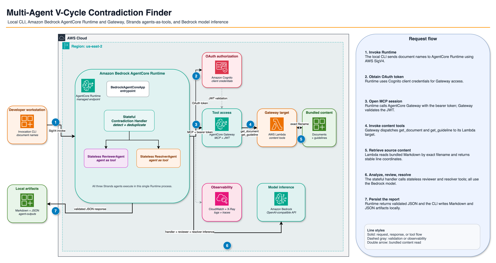

# Multi-Agent Contradiction Finder

V-cycle projects distribute architecture decisions, requirements, safety rules,
and implementation constraints across separate documents. A statement can look
correct in isolation while contradicting a rule or a chain of implications in
another artifact. This sample demonstrates how a small Strands multi-agent
system can find those cross-document contradictions, independently review them,
and suggest corrections.

## How it works

The sample uses the Strands agents-as-tools pattern:

1. The stateful `contradiction_handler_agent` checks one document against its
   guideline or analyzes two or more documents as one corpus. It deduplicates
   findings and composes reasoning chains that may span several artifacts.
2. The stateless `reviewer_agent` receives the complete candidate batch in one
   tool call and rejects false positives or subjective guideline complaints.
3. The stateless `contradiction_resolver_agent` receives only confirmed
   findings and proposes one to three corrections for each.
4. Pydantic models validate evidence, reviewer verdicts, resolutions, and the
   final report before it is returned.

Findings use only two classifications: `contradiction` for conflicts between
documents and `guideline_violation` for a one-document compliance failure.
Terms such as direct, transitive, and conditional describe the reasoning, not
the API classification.

The local CLI supplies two or more document contents directly for contradiction
analysis. The AgentCore variant accepts one to nine document names and retrieves
each document and its corresponding guideline through AgentCore Gateway. One
name selects guideline-compliance mode; two or more select cross-document
contradiction mode. AgentCore Runtime hosts the Strands workflow; the Gateway
Lambda only serves Markdown content with stable source line numbers.

## Introduced contradictions

The workshop documents deliberately contain three cross-document
contradictions:

- A direct conflict over whether WiFi manual trim may bypass `mower_logic`.
- A transitive conflict between the `COMMAND_HOME` docking sequence and the
  required blade state while travelling to the charger.
- A conditional/temporal conflict over replaying a queued start command before
  refreshed safety status is available after WiFi reconnect.

The complete validation key is
[introduced-contradictions.md](../demo-helper-artifacts/introduced-contradictions.md).
It is not packaged into the Gateway or supplied to any agent at runtime.

### Run the acceptance cases

Deploy the AgentCore sample first, then invoke these cases from the repository
root. Finding identifiers are generated per run; use the title and
source evidence to match the output to the cases below.

Find C1, the direct WiFi manual-trim routing contradiction:

```bash
.venv/bin/python v-cycle-contradiction-finder/invoke_agentcore.py \
  01-System-Architecture.md \
  02-System-Requirements.md
```

Find C2, the transitive three-document docking contradiction:

```bash
.venv/bin/python v-cycle-contradiction-finder/invoke_agentcore.py \
  01-System-Architecture.md \
  02-System-Requirements.md \
  11-User-Acceptance-Test.md
```

Find C3, the conditional WiFi reconnect contradiction:

```bash
.venv/bin/python v-cycle-contradiction-finder/invoke_agentcore.py \
  01-System-Architecture.md \
  02-System-Requirements.md
```

Find G1, the requirements-guideline routing violation:

```bash
.venv/bin/python v-cycle-contradiction-finder/invoke_agentcore.py \
  02-System-Requirements.md
```

C1 and C3 share the same two-document corpus and should normally be returned in
the same report. C2 is accepted only when its `contradiction` finding cites all
three supplied documents and explains the complete implication chain.

## Local run

Ensure the AWS SSO session is valid, then run from the repository root:

```bash
.venv/bin/python v-cycle-contradiction-finder/find_contradictions.py \
  workshop-current-state-documentation/01-System-Architecture.md \
  workshop-current-state-documentation/02-System-Requirements.md
```

The Markdown report is followed by a prompt for stateful questions. Add
`--no-interactive` for a one-shot run. The latest Markdown and JSON reports are
always written to `agent-outputs`; `--json PATH` writes an additional JSON copy
to the requested location.

Every successful local or AgentCore CLI call also writes the latest Markdown
and JSON reports to:

```text
v-cycle-contradiction-finder/agent-outputs/contradiction-report.md
v-cycle-contradiction-finder/agent-outputs/contradiction-report.json
```

The program reads `AWS_REGION`, `OPENAI_BASE_URL`, and `MODEL_ID` from `.env`
in the repository root and authenticates with
`aws_bedrock_token_generator.provide_token`. `.env` is not tracked; create it
from the committed template:

```bash
cp .env.example .env
```

Variables already exported in the shell take precedence over `.env`. Keep
`AWS_REGION` consistent with the region in `OPENAI_BASE_URL`; a mismatch fails
with `401 - Credential should be scoped to a valid region`.

## AgentCore deployment

The deployment creates:

- an AgentCore Runtime named `vcycle_contradiction_finder`;
- an AgentCore Gateway with a single Lambda target;
- a Cognito client-credentials authorizer for Runtime-to-Gateway access;
- `get_document` and `get_guideline` Gateway tools containing all nine project
  documents and all nine guidelines.

### Architecture



The editable source is available as
[agentcore-contradiction-finder.drawio](../docs/agentcore-contradiction-finder.drawio).
The numbered flow follows one request from the local CLI through content
retrieval, multi-agent analysis, and report persistence.

The deployment has four main boundaries:

- **AgentCore Runtime** hosts one Python process and one managed agent endpoint.
  The handler, reviewer, and resolver are Strands agents inside that process.
  Reviewer and resolver are exposed to the handler with `as_tool()`; they are
  not separate AgentCore runtimes or separately deployed services.
- **AgentCore Gateway** exposes exactly two MCP tools: `get_document` and
  `get_guideline`. It is the controlled content-access boundary between the
  agent and the V-cycle artifacts.
- **Lambda target** dispatches Gateway tool calls and reads Markdown files
  bundled in its deployment package. It accepts exact filenames, prevents path
  traversal, and adds stable `[filename:line]` coordinates. It performs no
  model inference and contains no agent logic.
- **Bedrock model endpoint** serves all three Strands agents through its
  OpenAI-compatible API. The Runtime execution role includes scoped Mantle
  inference permissions required by the token generator and model call.

Authentication uses two independent paths. The local invocation CLI calls
AgentCore Runtime with AWS SigV4 credentials from the active AWS session. The
Runtime then obtains a Cognito client-credentials token and presents it to the
Gateway as an OAuth bearer token. Gateway validates the JWT and assumes its IAM
role to invoke only the configured Lambda target.

For each request, the Runtime:

1. Validates that the payload contains 1-9 unique plain Markdown filenames.
2. Opens an authenticated MCP session with Gateway.
3. Retrieves every requested document and its matching guideline.
4. Stops with a zero-finding failure report if any retrieval fails.
5. Checks one document against its guideline, or runs whole-corpus contradiction
   detection for two or more documents.
6. Sends a nonempty candidate batch to the reviewer in one agent-tool call.
7. Sends only confirmed findings to the resolver in one agent-tool call.
8. Returns the Pydantic-validated report to the CLI, which writes the latest
   Markdown and JSON artifacts under `agent-outputs`.

CloudWatch logs and X-Ray tracing are enabled for the Runtime. Deployment IDs
and Cognito credentials are kept in the ignored local state file, and the
credentials are passed to the Runtime as environment variables. The cleanup
script uses the saved IDs to remove dedicated resources while preserving shared
account resources.

Install the deployment dependencies into the supplied environment:

```bash
.venv/bin/pip install \
  -r v-cycle-contradiction-finder/requirements-deploy.txt
```

Deploy or update all resources:

```bash
.venv/bin/python v-cycle-contradiction-finder/deploy_agentcore.py
```

The script is idempotent and refuses to deploy outside account `974155583980`
and region `us-east-2`. It does not modify other AgentCore runtimes. Cognito
client credentials and generated resource IDs are stored in the ignored
`v-cycle-contradiction-finder/.agentcore-deployment.json` with permissions
`0600`.

## Call the endpoint

The Runtime accepts between one and nine unique top-level Markdown filenames.
The CLI below invokes the deployed AgentCore endpoint.

With one document, check it against its corresponding guideline:

```bash
.venv/bin/python v-cycle-contradiction-finder/invoke_agentcore.py \
  02-System-Requirements.md
```

Equivalent payload:

```json
{
  "document_names": [
    "02-System-Requirements.md"
  ]
}
```

With two documents:

```bash
.venv/bin/python v-cycle-contradiction-finder/invoke_agentcore.py \
  01-System-Architecture.md \
  02-System-Requirements.md
```

Equivalent payload:

```json
{
  "document_names": [
    "01-System-Architecture.md",
    "02-System-Requirements.md"
  ]
}
```

With three documents:

```bash
.venv/bin/python v-cycle-contradiction-finder/invoke_agentcore.py \
  01-System-Architecture.md \
  02-System-Requirements.md \
  11-User-Acceptance-Test.md
```

Equivalent payload:

```json
{
  "document_names": [
    "01-System-Architecture.md",
    "02-System-Requirements.md",
    "11-User-Acceptance-Test.md"
  ]
}
```

Each successful local or AgentCore CLI call overwrites the latest reports under
`v-cycle-contradiction-finder/agent-outputs/`.

## Test

```bash
.venv/bin/python -m unittest discover \
  -s v-cycle-contradiction-finder/tests \
  -v
```

## Cleanup

Preview the resources that the cleanup command will remove:

```bash
.venv/bin/python v-cycle-contradiction-finder/destroy_agentcore.py
```

Delete the deployment, including its Cognito domain and user pool:

```bash
.venv/bin/python v-cycle-contradiction-finder/destroy_agentcore.py --yes
```

The cleanup preserves shared resources, including the AgentCore S3 bucket and
any Gateway IAM role still referenced by another Gateway. It removes the local
deployment state only after the AWS cleanup succeeds. Run `deploy_agentcore.py`
again afterward to create a fresh deployment.
